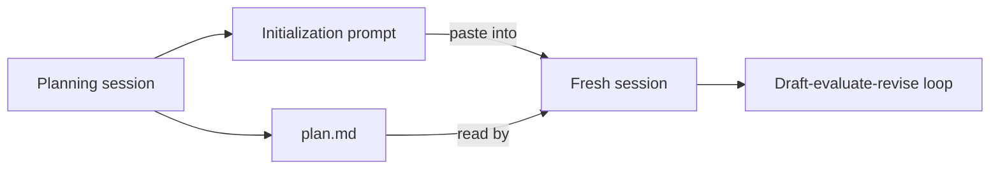
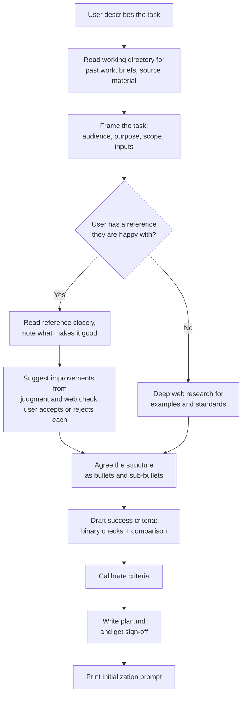
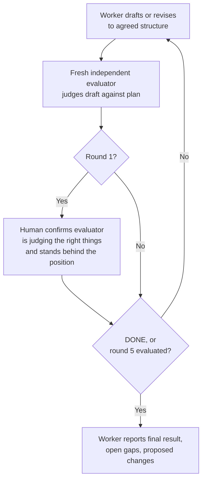

# grillstorm

grillstorm is an agent skill for AI coding tools (Claude Code, Codex, Cursor and others that read the open Agent Skills format). It runs a planning conversation with you before any drafting starts, then hands you a `plan.md` and a short initialization prompt. You paste that prompt into a fresh session or another tool, where a draft, independent-evaluator, revise loop does the work.

Version 0.1.0. [MIT License](LICENSE).

The following diagram shows the two phases and the handoff between them.



## The problem

Agent loops work well when the outcome can be verified: the agent writes code, a test fails, the agent fixes it. Reports, memos, policy briefs, strategy documents and slide decks have no test. What "good" means is in your head, so a loop with nothing to check against settles on output that is plausible and generic.

grillstorm builds the missing check first. In one planning conversation, you and the model agree on a structure for the deliverable and success criteria that an independent evaluator can apply to a draft without having seen the planning conversation. The plan then moves to a fresh session where the draft-evaluate-revise loop does the work.

## The planning session

The diagram below shows the full planning conversation, from your first message to the handoff. The whole conversation aims for six to ten replies from you.



1. **The model does its homework.** It reads your working directory for past deliverables, briefs, style guides, feedback on earlier work and source material. It stays inside the directory and does not search connected sources such as a document drive or mailbox unless you point it there. It then drafts a frame for the task and asks you only about the parts it could not settle from the directory.

2. **It finds the standard.** If you have a past deliverable you are satisfied with, the model reads it closely, works out what makes it good, and puts that reading to you as a short list of observations you can confirm or correct. It then suggests improvements drawn from its own judgment and a brief web check; you accept or reject each one. If you have no reference at all, the model runs a round of deep web research for well-regarded examples, guidance from institutions your audience trusts, and common complaints about this kind of deliverable, then summarizes what it found before proposing anything.

3. **You agree the structure and criteria.** The model proposes a structure for the deliverable, written strictly as bullets and sub-bullets, and a set of success criteria. It puts these in front of you as a strawman and asks what is wrong. Individual questions come only where you disagree, where something is unknown, or where a decision came from the model rather than from you.

4. **The model calibrates the criteria.** If you have a reference, it runs the binary checks against it: a check derived from the reference should pass, and one that represents a deliberate improvement should fail. Any mismatch means the wording needs fixing. It also checks whether an average draft would pass most of the set. If so, the criteria are too easy and get tightened.

5. **You get `plan.md` and an initialization prompt.** The plan holds the goal, spec, structure, success criteria, benchmark, loop protocol, an evaluator brief and a record of every decision you left to the model. The skill does not decide what the deliverable should conclude or recommend; that is left to you or to the worker. The prompt is a short block of text you paste into a new session or another tool.

## How the criteria work

### Binary checks

Each check is a statement about something observable in the draft that is either true or false. The evaluator must quote the passage that proves its verdict and cannot wave a check through without evidence. Each check also says how to test it, so that two evaluators would apply it the same way.

**Example.** For a policy brief, a check might read:

> **C4. Recommendations are actionable.** Every recommendation names the actor, the action and a time frame.
> - Check: List each recommendation and mark which of the three parts are present. Fail if any part is missing from any recommendation.

Compare this with "Recommendations are clear and useful", which any draft could claim to pass. The check tells the evaluator exactly what to look for.

### Benchmark comparison

If you have a past deliverable you are satisfied with, the evaluator reads the new draft next to it and says which is stronger on three to five dimensions of craft. The benchmark is usually about a different topic, so dimensions are about how the work is done, not what it is about.

**Example.**

> **D2. Density.** Which document gives the reader more usable content per page? Stronger means fewer sentences that restate, hedge or set up.

A draft can pass every binary check and still read worse than your best work overall. The comparison catches that gap. When no reference is available, the loop runs on binary checks alone.

## The loop

When you paste the initialization prompt into a fresh session, the following cycle runs.



1. The worker drafts the deliverable to the agreed structure.
2. It starts a fresh, independent evaluator sub-agent with the evaluator brief from the plan. The evaluator sees the plan's goal, spec, structure, criteria and benchmark, plus the draft, but nothing from the worker's conversation.
3. **After round 1, the worker pauses.** You confirm that the evaluator is judging the right things and that the position the draft takes is one you stand behind. You may amend the criteria or settle the position; changes are recorded in the plan.
4. After you confirm, the loop runs without check-ins until every binary check passes and the draft wins or ties every comparison dimension, or until round 5 has been evaluated.
5. At the stop, the worker reports the final result, any checks still failing, every gap flagged for you to fill, and any changes to the criteria it would propose.

Only you can change the structure, the criteria and the benchmark. The worker may propose changes but cannot make them.

If the tool cannot start sub-agents, the worker pauses after each draft and gives you the evaluator brief to run in a separate session.

## Install

The skill is one folder, `skills/grillstorm/`, in the open Agent Skills format (a `SKILL.md` plus bundled files).

### Claude Code, as a plugin

```bash
claude plugin marketplace add Lego1997/grillstorm
```

```bash
claude plugin install grillstorm@grillstorm
```

Invoke with `/grillstorm:grillstorm`.

### Claude Code, as a personal skill

```bash
git clone https://github.com/Lego1997/grillstorm
```

```bash
mkdir -p ~/.claude/skills && cp -r grillstorm/skills/grillstorm ~/.claude/skills/
```

Invoke with `/grillstorm`.

### Cursor

Copy `skills/grillstorm/` to `.cursor/skills/grillstorm/` in your project. Cursor also reads `~/.claude/skills/`, so the personal Claude Code install above covers both.

### Codex

Copy `skills/grillstorm/` to `~/.agents/skills/grillstorm/` (older versions read `~/.codex/skills/`). Invoke with `$grillstorm`. Codex skill paths have moved between releases; check OpenAI's docs if this does not work.

### Other tools

Any tool that reads Agent Skills can use the folder as is. In a tool without skill support, paste the contents of `SKILL.md` as your first message and attach the files in `assets/` and `references/`.

## Usage

Start it when you are about to begin a substantial deliverable:

> /grillstorm I need to write a policy brief on compute governance for our board next week.

The skill does not write the deliverable. It stops after handing you the plan and the initialization prompt.

## Design choices

**Why binary checks with quoted evidence?** Without the quote requirement, an evaluator can pass a check on impression. Requiring a quoted passage for every verdict means a check with no supporting text in the draft is a FAIL.

**Why compare against your own best work?** Binary checks test individual properties. Side-by-side comparison catches what they miss: coherence, density, how quickly a reader gets to the point.

**Why calibrate against the reference before signing off?** Criteria are instructions to an evaluator, and instructions can be wrong. Running the checks against the benchmark before the loop starts catches wording that does not match what you actually meant.

**Why not write the deliverable in the same session?** The evaluator has to judge a draft by what is on the page, not by what it heard you explain. A session that has heard all the planning reasoning will be generous with a draft it helped shape. The plan needs a fresh worker and a fresh evaluator.

## Status

The skill has been dry-run three times with simulated users: twice with a user who had a past brief as reference, once with a user who had no reference. Those runs produced complete plans and initialization prompts and led to two rounds of revisions to the skill's wording. It has not yet been used by a real person on a real deliverable. The evaluation loop that the initialization prompt starts has not been run end to end, and the latest wording changes have not been re-run. Treat it as an early draft.

## Repo layout

```
.claude-plugin/          plugin and marketplace manifests for Claude Code
skills/grillstorm/
  SKILL.md               the skill workflow
  assets/
    plan-template.md     the plan the skill fills in
    init-prompt-template.md
  references/
    criteria-guide.md    how to write criteria an evaluator can apply
```

## Credits

Inspired by Matt Pocock's [grill-me skill](https://github.com/mattpocock/skills), which interviews you about a plan one question at a time, and by co-brainstorming with AI as a way of working.

## 中文简介

grillstorm 是用于 Claude Code、Codex、Cursor 等 AI 工具的 agent skill。它要解决的问题是：代码可以靠测试验证，适合让模型循环迭代；但报告、备忘录、政策简报这类知识工作没有测试可跑，循环无从判断好坏，产出容易流于空洞。

grillstorm 在动笔之前先和你进行一轮结构化讨论，产出一份 `plan.md` 和一段初始化提示词。计划包含：

- 交付物的结构（严格使用层级要点）
- 成功标准：可由独立评估 sub-agent 逐条判定的二元检查项（每条必须引用原文为证据），以及与你的参照作品在几个工艺维度上的并排比较

标准的来源取决于你是否有满意的过往作品。有参照作品时，模型先仔细阅读，提炼出优点让你确认，再提出改进建议（结合自身判断和简要的网络查阅），由你逐条取舍。没有参照作品时，模型先做一轮深度网络研究，找到公认的优秀范例和相关指南，再向你汇报发现、提出标准。模型将结构和标准作为草案完整呈现，问你哪里有问题，只在你有异议、信息未知或决定出自模型时才单独提问。签字前，模型用参照作品试跑检查项来校准：源自作品的检查项应当通过，代表刻意提升的检查项应当不通过；如果普通初稿也能通过大部分检查项，说明标准太松，需要收紧。

讨论结束后你会得到一段初始化提示词，贴到新 session 或其他工具中即可启动循环：执行者起草，独立评估者依据计划判定草稿，第一轮后暂停一次请你确认评估方向和草稿立场，此后自动运行至全部通过或第 5 轮评估完成。执行者结束时汇报最终结果、仍未通过的检查项、需要你填补的空缺，以及它建议的标准修改。只有你可以修改结构、标准和参照作品，执行者可以提议但无权自行变更。如果工具无法启动 sub-agent，执行者会在每轮草稿后暂停，交给你在另一个 session 中运行评估。

计划中记录了你委托模型做的每一个决定，方便事后查阅。交付物的实质主张（结论、建议）留给你或执行者决定，不在规划阶段锁定。

注意：该 skill 只读取当前工作目录中的文件，不会主动搜索文档云盘或邮箱，除非你明确指向。

当前状态：版本 0.1.0，已用模拟用户干跑三次（两次有参考作品，一次没有），并据此修订了两轮措辞。尚未经真实用户在真实任务上使用，评估循环未完整跑通，最新措辞改动未重新测试。请视为早期草稿。

[MIT License](LICENSE).
